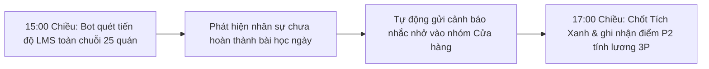

# CẨM NANG SỬ DỤNG BỘ KỸ NĂNG ROSIER (RS-*) CHO PHÒNG ĐÀO TẠO (ROSIER LMS)

> **Mục tiêu Trọng tâm:** Chuẩn hóa quy trình sản xuất khóa học từ SOP thô, điểm danh học tập tự động chốt Tích Xanh lúc 17:00 hàng ngày, và vận hành lộ trình 15 ngày nhập môn cho 5 vị trí cửa hàng.
> **Đối tượng sử dụng:** Chuyên viên Đào tạo, Quản lý Học viện LMS, Giảng viên nội bộ.

---

## 1. Danh Mục Các Lệnh Skill Chính

| Nhóm Nghiệp Vụ | Câu Lệnh Copy-Paste Trên Antigravity | Thao Tác Thả File / Dữ Liệu | Kết Quả Máy Trả Về |
| :--- | :--- | :--- | :--- |
| **Sản xuất Khóa học từ Đề cương / SOP** | `/rs-lms-course-factory đóng gói khóa học từ tài liệu SOP [Tên SOP]` | Cung cấp file Word SOP hoặc nội dung bài giảng thô | Khóa học chuẩn LMS gồm video kịch bản, nội dung wiki và tài liệu đọc |
| **Chuyển Slide Đào tạo thành Khóa học LMS** | `/rs-lms-slide-to-course chuyển slide đào tạo thành khóa học hoàn chỉnh` | Thả file Slide (PPTX / PDF) bài giảng vào thư mục | Video bài giảng 1080p + Wiki tóm tắt + Bộ câu hỏi trắc nghiệm đính kèm |
| **Tạo Ngân hàng Câu hỏi Trắc nghiệm Bloom** | `/rs-lms-bloom-quiz-engine tạo 20 câu hỏi trắc nghiệm theo 6 cấp độ Bloom` | Cung cấp tài liệu nội dung bài học cần kiểm tra | Bộ câu hỏi phân tầng 6 cấp độ (Nhớ -> Hiểu -> Vận dụng -> Sáng tạo) |
| **Điểm danh Tự động & Chốt Tích Xanh 17:00** | `/rs-wf-lms-daily-1700-green-tick điểm danh học tập ngày [DD/MM/YYYY]` | Không cần file, máy tự quét dữ liệu tiến độ LMS | Báo cáo tỷ lệ hoàn thành toàn chuỗi lúc 15:00 và danh sách nhân sự chưa đạt trước 17:00 |
| **Thiết lập Lộ trình Nhập môn 15 ngày** | `/rs-lms-onboarding-path tạo lộ trình học nhập môn cho vị trí [Barista/Thu ngân]` | Chọn vị trí nhân sự mới tuyển dụng | Lộ trình 15 ngày học tập lý thuyết kết hợp thực hành tại quầy bar |
| **Lập Bộ Trắc nghiệm Hình ảnh Trực quan** | `/rs-kb-notebooklm-visual-quiz-pack tạo bộ trắc nghiệm nhận diện lỗi pha chế` | Cung cấp danh mục lỗi quầy bar thường gặp | Bộ đề thi nhận diện ảnh trực quan (màu cốt trà, lớp foam, độ mịn đá) |
| **LỆNH VẠN NĂNG** | `/rs-auto [yêu cầu tiếng Việt bất kỳ]` | Gõ trực tiếp yêu cầu đào tạo | Tự động chọn đúng Skill LMS để xử lý |

---

## 2. Quy Trình Vận Hành Mẫu: Điểm Danh Tích Xanh 17:00 Hàng Ngày

