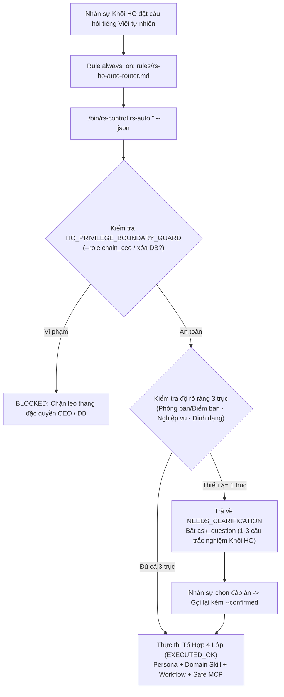

# Kiến Trúc Tách Đặc Quyền CEO, Khóa An Toàn Database & Định Tuyến Tự Động Khối HO (`v6.5.0-ho.1`)

Tài liệu giải thích lý do thiết kế (`Why`), kiến trúc bảo mật đa tầng và các đánh đổi kỹ thuật (`Trade-offs`) của **Kho Kỹ Năng Khối Văn Phòng HO Rosier (`rosier-ho-skills` · `v6.5.0-ho.1` · `HO_STAFF_SAFE_EDITION`)**.

---

## The problem

Trong quá trình mở rộng vận hành chuỗi 25 điểm bán (`3` điểm bán công ty `38197`, `46880`, `87024` và `22` điểm bán nhượng quyền Hộ Kinh Doanh), nếu cấp nguyên bản kho kỹ năng tổng (`rosier-skills` · `202` hợp phần) của CEO cho nhân sự các phòng ban Khối Văn Phòng HO sẽ phát sinh 3 rủi ro nghiêm trọng:

1. **Rò rỉ đặc quyền điều hành tối cao & chiến lược M&A/HĐQT:** Kho gốc chứa các kỹ năng hoạch định cấu trúc vốn, thẩm định M&A, tờ trình HĐQT (`rs-persona-chain-ceo`, `rs-exec-board-deck`, `rs-exec-ma-expansion-eval`) và các công cụ can thiệp nhân hệ thống (`rs-eng-kernel-sot-bo02`, `rs-meta-skill-evolver`).
2. **Rủi ro ghi đè hoặc xóa nhầm Database gốc:** Kho gốc có các lệnh CLI `reset-db`, `seed` và các công cụ MCP cho phép ghi trực tiếp vào Hub quản trị (`rs-mcp-hub-business-upsert`) hoặc xuất sổ cái thuế nhạy cảm (`rs-mcp-finance-tax-ledger-export`). Một thao tác nhầm của nhân sự HO có thể làm sai lệch dữ liệu vận hành toàn chuỗi.
3. **Rào cản ghi nhớ tên kỹ năng (`Cognitive Overload`):** Nhân sự nghiệp vụ tại 6 Khối Phòng Ban HO (Vận hành, Cung ứng, Kế toán, Nhân sự, Đào tạo LMS, Marketing/CSKH) không thể nhớ tên 126 mã kỹ năng `rs-*` để gõ lệnh thủ công, đồng thời khi kho gốc cập nhật quy trình mới thì máy trạm của nhân sự dễ bị tụt hậu phiên bản.

---

## The approach

Để giải quyết triệt để cả 3 bài toán trên mà không phải duy trì hai nhánh mã nguồn thủ công rời rạc, `rosier-ho-skills` áp dụng kiến trúc **Biên Dịch Khử Đặc Quyền Một Chiều (`Deterministic Privilege-Pruning Compiler`)** kết hợp **Định Tuyến Tự Động Không Cần Lệnh (`Zero-Command Auto`)** và **Đồng Bộ Tự Động 24h Có Nhánh Cứu Hộ (`Dual-Sync Auto-Updater`)**.

### 1. Sơ Đồ Kiến Trúc ASCII (`Grep-Friendly Architecture Map`)

```text
+-------------------------------------------------------------------------+
|                UPSTREAM: rosier-skills (202 Items - CEO)                |
+-------------------------------------------------------------------------+
                                    |
                                    v
+-------------------------------------------------------------------------+
|       COMPILER & SANITIZER: scripts/build_and_sync_ho_repo.py           |
|  - Prune 16 CEO/Board/M&A & Core/System Skills  -> Keep 126 HO Skills   |
|  - Prune 2 CEO Daily Pulse Workflows            -> Keep 28 Workflows    |
|  - Prune 2 MCP Modules & 2 DB-Write Tools       -> Keep 24 Safe Tools   |
|  - Inject allow_db_mutation = False & Remove reset-db / seed            |
+-------------------------------------------------------------------------+
                                    |
                                    v
+-------------------------------------------------------------------------+
|           TARGET: rosier-ho-skills (178 Items - Khối HO)                |
+-------------------------------------------------------------------------+
       |                            |                            |
       v                            v                            v
+--------------------+   +-----------------------+   +--------------------+
| Zero-Command Auto  |   | DB Boundary Guard     |   | 24h Auto-Updater   |
| rules/rs-ho-auto-  |   | HO_SAFE_READ_AND_DRAFT|   | rs_ho_auto_updater |
| router.md (always) |   | Blocks mutate_db,     |   | Fast-forward pull, |
| + 3-Axis Question  |   | reset-db, chain_ceo   |   | Rescue Ref backup  |
+--------------------+   +-----------------------+   +--------------------+
```

### 2. Sơ Đồ Luồng Xử Lý Câu Hỏi Của Nhân Sự HO (`Mermaid Sequence`)



---

## Trade-offs

1. **Chúng tôi chọn chế độ `HO_SAFE_READ_AND_DRAFT` (chỉ đọc và tạo bản nháp trình duyệt) thay vì cho phép nhân sự HO ghi trực tiếp vào Database thông qua phân quyền mềm (`Soft RBAC`):**
   - *Đánh đổi:* Nhân sự HO cần một bước phê duyệt bản nháp (`Draft Staging`) trước khi dữ liệu chính thức ghi vào sổ cái hoặc Hub quản trị.
   - *Lợi ích đạt được:* Loại bỏ `100%` nguy cơ một câu lệnh AI tự động ghi đè hoặc xóa nhầm dữ liệu vận hành của 25 điểm bán.
2. **Chúng tôi chọn cơ chế hỏi lại 3 trục (`3-Axis Clarification Gate`) thay vì để AI tự đoán mô hình pháp nhân của điểm bán:**
   - *Đánh đổi:* Khi câu hỏi ngắn hoặc mơ hồ (ví dụ: *"Kiểm tra định mức và tồn kho tháng này"*), nhân sự mất thêm `1` cú click chọn đáp án trắc nghiệm.
   - *Lợi ích đạt được:* Tránh áp dụng nhầm quy tắc kế toán/thuế của cụm `3` điểm bán Công ty TNHH (`38197`, `46880`, `87024`) sang khối `22` điểm bán nhượng quyền Hộ Kinh Doanh (`CHNQ`).
3. **Chúng tôi chọn cập nhật `git merge --ff-only` kèm nhánh cứu hộ `Rescue Ref` thay vì `git reset --hard origin/main`:**
   - *Đánh đổi:* Cần thêm logic phát hiện `dirty worktree` trong `scripts/rs_ho_auto_updater.py`.
   - *Lợi ích đạt được:* Không bao giờ làm mất các ghi chú hoặc cấu hình cục bộ trên máy tính của nhân sự HO khi trình cập nhật định kỳ 24h chạy ngầm.

---

## Alternatives considered

1. **Phương án 1 (Đã loại bỏ): Dùng chung một kho GitHub `rosier-skills` cho cả CEO và nhân sự Khối HO, ẩn các skill CEO bằng cờ cấu hình `.env` trên máy nhân sự.**
   - *Lý do loại bỏ:* Bất kỳ ai có quyền `git clone` kho gốc đều đọc được toàn bộ nội dung `SKILL.md` đặc quyền của CEO/HĐQT/M&A và có thể tự bật lại cờ trong `.env` hoặc gọi trực tiếp script `reset-db`. Việc tách thành kho độc lập `rosier-ho-skills` đã cắt bỏ vật lý các file đặc quyền ngay từ tầng mã nguồn.
2. **Phương án 2 (Đã loại bỏ): Chỉnh sửa thủ công từng file trong `rosier-ho-skills` mỗi khi có thay đổi nghiệp vụ.**
   - *Lý do loại bỏ:* Dễ gây lệch chuẩn (`Drift`) giữa kho CEO và kho Khối HO. Sử dụng trình biên dịch tự động [`scripts/build_and_sync_ho_repo.py`](../scripts/build_and_sync_ho_repo.py) giúp đồng bộ mọi nâng cấp nghiệp vụ từ kho gốc sang kho Khối HO chỉ trong 2 giây mà vẫn đảm bảo cắt sạch 100% đặc quyền CEO.

---

## Related

- **Tutorial (Làm quen trong 3 bước):** [docs/tutorial-getting-started-ho-staff.md](tutorial-getting-started-ho-staff.md)
- **How-To (Hướng dẫn tác vụ thực tế):** [docs/howto-operations-and-auto-update.md](howto-operations-and-auto-update.md)
- **Reference 126 HO Skills & 28 Workflows:** [docs/reference-packages-and-skills.md](reference-packages-and-skills.md)
- **Reference CLI & 24 Safe MCP Tools:** [docs/reference-cli-and-api.md](reference-cli-and-api.md)
