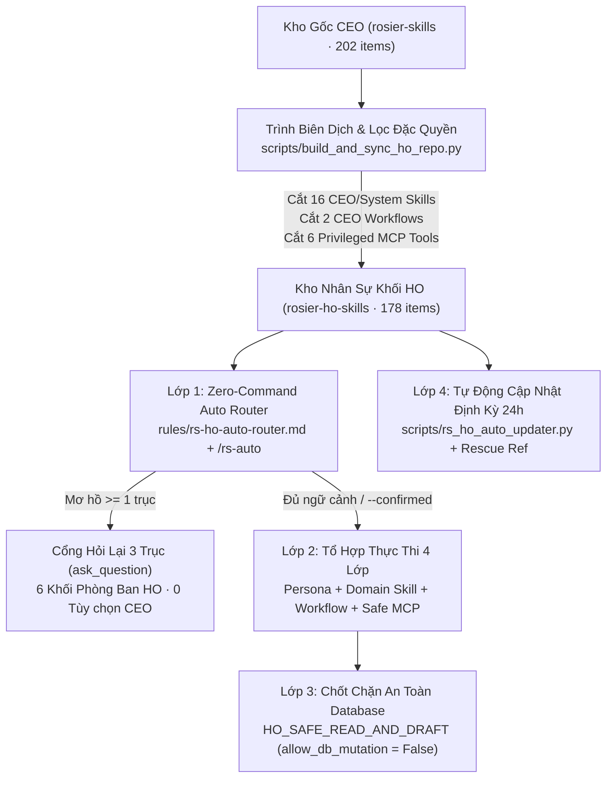

# 01. Kiến Trúc, Mô Hình Phân Quyền & Chốt Chặn Bảo Mật Khối HO (`v6.5.0-ho.1`)

Tài liệu giải thích kiến trúc của **Kho Kỹ Năng Khối Văn Phòng HO Rosier (`rosier-ho-skills` · `v6.5.0-ho.1` · `HO_STAFF_SAFE_EDITION`)**, cơ chế tách đặc quyền từ kho gốc và các chốt chặn bảo mật đa tầng.

---

## 1. Sơ Đồ Kiến Trúc Tổng Thể (`Architecture Flowchart`)

---

## 2. Cơ Chế Tách Biệt Đặc Quyền (`HO Privilege Boundary Guard`)

| Nhóm hợp phần bị cắt bỏ khỏi bản Khối HO | Số lượng | Danh sách ID bị loại bỏ | Lý do bảo mật |
|---|---|---|---|
| **Nhóm 1: Điều hành tối cao CEO, HĐQT & M&A** | `6` Skills | `rs-persona-chain-ceo`, `rs-exec-morning-digest`, `rs-exec-day-planner`, `rs-exec-knowledge-router`, `rs-exec-board-deck`, `rs-exec-ma-expansion-eval` | Đặc quyền hoạch định chiến lược vốn, M&A và điều hành riêng của CEO Toàn Chuỗi |
| **Nhóm 2: Quản trị Nhân hệ thống & Cổng bảo mật gốc** | `5` Skills | `rs-eng-kernel-sot-bo02`, `rs-eng-skill-factory-architect`, `rs-eng-skillspector-security-gate`, `rs-eng-mcp-gateway-inspector`, `rs-eng-release-ship-pipeline` | Chặn nhân sự HO tự ý thay đổi cấu trúc Kernel, khóa SOT hoặc phát hành đè hệ thống |
| **Nhóm 3: Tự tiến hóa Hệ thống & Tự động hóa Máy chủ** | `5` Skills | `rs-meta-persona-distiller`, `rs-meta-skill-evolver`, `rs-meta-prompt-diagnostics`, `rs-meta-agent-swarm-worktree`, `rs-meta-mac-native-automation` | Chặn tự sinh tiến trình hệ thống hoặc sửa đổi mã nguồn nội bộ |
| **Nhóm 4: Nhịp sinh học cá nhân CEO** | `2` Workflows | `rs-wf-exec-0730-morning-pulse`, `rs-wf-exec-2230-evening-wrap` | Quy trình giao ban cá nhân 07:30 và 22:30 của CEO |
| **Nhóm 5: Mô-đun & Công cụ MCP Ghi Đè DB / Xuất Sổ Cái Thuế** | `2` Modules / `6` Tools | `rs-mcp-dmz-bridge`, `rs-mcp-governance-guard`, `rs-mcp-hub-business-upsert`, `rs-mcp-finance-tax-ledger-export` | Khóa cứng quyền ghi đè trực tiếp Database gốc và xuất sổ cái thuế tối mật |

---

## 3. Chốt Chặn An Toàn Database (`HO_SAFE_READ_AND_DRAFT`)

1. **Khóa cứng `allow_db_mutation = False`:** Toàn bộ `8` mô-đun MCP và `24` công cụ MCP trong `mcp-modules/` chỉ cho phép truy vấn dữ liệu (`Read-Only`) và tạo bản nháp trình duyệt (`Draft Staging`).
2. **Chặn cờ đột biến dữ liệu (`FORBIDDEN_DB_FLAGS`):** Mọi lời gọi truyền `mutate_db`, `direct_db_write`, `reset_db`, `force_overwrite_db` hoặc `drop_table` đều bị chặn với mã lỗi `HO_DB_MUTATION_FORBIDDEN`.
3. **Loại bỏ lệnh CLI nguy hiểm:** Lệnh `reset-db` và `seed` đã bị gỡ bỏ khỏi `./bin/control-app`, `./bin/rs-control` và `scripts/rs_os_control_tool.py`.
4. **Chặn điểm bán đóng cửa vĩnh viễn (`Closed Store Blocker`):** Mọi truy vấn vào mã điểm bán `115953` và `106192` đều bị chặn tự động tại `core/rs_core_engine.py` và các MCP server.
