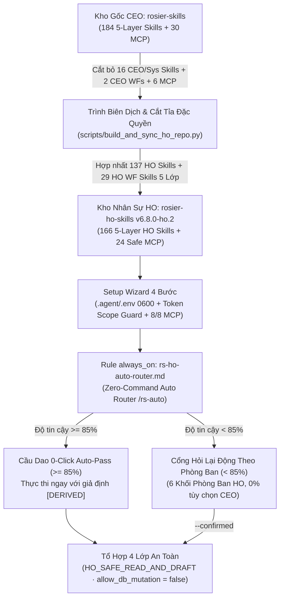

# Kiến Trúc Tách Đặc Quyền CEO, Bảo Vệ Database & Định Tuyến Tự Động Khối HO (`v6.8.0-ho.2`)

Tài liệu giải thích kiến trúc (`Explanation`) trình bày lý do thiết kế, cơ chế tách quyền hạn giữa kho gốc của CEO (`rosier-skills` · `213` hợp phần) và kho dành riêng cho nhân sự Khối Văn Phòng HO (`rosier-ho-skills` · `189` hợp phần), cùng các hàng rào kỹ thuật bảo vệ cơ sở dữ liệu.

---

## 1. Tại Sao Phải Tách Riêng Kho Kỹ Năng Khối HO (`rosier-ho-skills`)?

Trong vận hành chuỗi F&B **Rosier Fresh Tea & Coffee** (`25` điểm bán đang hoạt động: `03` cửa hàng công ty `CHH` + `22` cửa hàng nhượng quyền `CHNQ`), kho kỹ năng gốc `rosier-skills` (`213` hợp phần) chứa các công cụ điều hành tối cao của CEO Toàn Chuỗi (như trình hội đồng quản trị, thẩm định M&A, cầu dao khẩn cấp DMZ, công cụ ghi đè/khởi tạo lại cơ sở dữ liệu kiểm thử và xuất sổ cái quyết toán thuế gốc).

Nếu cấp nguyên bản `213` hợp phần cho toàn bộ máy tính nhân sự Khối Văn Phòng HO sẽ dẫn đến 3 rủi ro lớn:
1. **Rủi ro ghi đè hoặc xóa nhầm Database (`Accidental DB Mutation`):** Nhân sự chạy nhầm các lệnh `reset-db`, `seed`, `notebook_delete` hoặc `business-upsert` làm mất dữ liệu thật trên Hub 1 `ROSIER BUSINESS` hoặc sổ cái công nợ.
2. **Rủi ro lộ lọt thông tin nhạy cảm cấp HĐQT/CEO (`Privilege Leakage`):** Các kỹ năng dành riêng cho CEO Toàn Chuỗi (`rs-exec-morning-digest`, `rs-exec-board-deck`, `rs-exec-ma-expansion-eval`, `rs-persona-chain-ceo`) không thuộc phạm vi công việc hàng ngày của chuyên viên HO.
3. **Rào cản nhận thức khi có quá nhiều mã kỹ năng (`Cognitive Overload`):** Nhân sự văn phòng thuộc 6 khối chức năng không thể nhớ hàng trăm mã lệnh `/rs-...`.

Do đó, `rosier-ho-skills` (`v6.8.0-ho.2`) được biên dịch tự động từ `rosier-skills` qua trình biên dịch một chiều `scripts/build_and_sync_ho_repo.py` để giữ lại đúng **`189` hợp phần phục vụ 100% nghiệp vụ của 6 Khối Phòng Ban HO** trong một môi trường an toàn tuyệt đối.

---

## 2. Sơ Đồ Kiến Trúc Tổng Thể (`Architecture Overview`)

---

## 3. Ba Hàng Rào Bảo Vệ Kỹ Thuật Cốt Lõi (`Core Security Guardrails`)

### 3.1. Cắt bỏ Vật lý Đặc quyền CEO & Công cụ Can thiệp Hệ thống (`Physical Pruning`)
Thay vì chỉ ẩn bằng cấu hình mềm, `build_and_sync_ho_repo.py` **loại bỏ vật lý hoàn toàn** khỏi kho `rosier-ho-skills`:
- **`16` Kỹ năng CEO & Hệ thống:** `rs-exec-morning-digest`, `rs-exec-day-planner`, `rs-exec-knowledge-router`, `rs-exec-board-deck`, `rs-exec-ma-expansion-eval`, `rs-exec-task-dispatch-auto`, `rs-persona-chain-ceo` và `9` kỹ năng `rs-eng-*`/`rs-meta-*` can thiệp kiến trúc lõi.
- **`2` Quy trình riêng của CEO:** `rs-wf-exec-0730-morning-pulse` và `rs-wf-exec-2230-evening-wrap` (trên cả `skills/` và `workflows/`).
- **`6` Công cụ MCP đặc quyền:** Toàn bộ mô-đun `rs-mcp-dmz-bridge`, `rs-mcp-governance-guard` cùng 2 công cụ ghi nhạy cảm `rs-mcp-hub-business-upsert` và `rs-mcp-finance-tax-ledger-export`.

### 3.2. Khóa Cứng Chế Độ `HO_SAFE_READ_AND_DRAFT` (`Zero DB Mutation` & `BOM 3-Stage Gate`)
- Ở tầng Kernel (`core/rs_core_engine.py`), hằng số `HO_EDITION_LOCK = True` và `ALLOW_DB_MUTATION = False` chặn mọi yêu cầu có `--role chain_ceo` hoặc lệnh `reset-db`/`seed`.
- Ở tầng NotebookLM Studio (`#144..#151`), chặn cứng 4 công cụ xóa (`notebook_delete`, `source_delete`, `collection_delete`, `studio_delete`) với mã lỗi `HO_DESTRUCTIVE_NOTEBOOKLM_TOOL_FORBIDDEN`.
- Ở tầng Sổ cái BOM (`#015 rs-kb-recipe-rd-vault`), chặn vĩnh viễn lệnh xóa (`IMMUTABLE_BOM_DELETE_FORBIDDEN`) và yêu cầu phê duyệt 3 chốt (`R&D -> Cung ứng -> CEO`) trước khi kích hoạt công thức mới.

### 3.3. Bộ Định Tuyến Thích Ứng 10-Sao (`0-Click Auto-Pass >= 85%` & Cổng Hỏi Lại Động `< 85%`)
- Khi nhân sự HO đặt câu hỏi rõ chủ thể hoặc động từ nghiệp vụ (`Độ tin cậy >= 85.0%`), **Cầu Dao 0-Click Auto-Pass** tự động điền giả định hợp lý (`[DERIVED]`) và thực thi ngay tổ hợp 4 lớp không ngắt quãng.
- Khi câu hỏi thực sự thiếu dữ kiện (`< 85.0%`), hệ thống sinh câu hỏi trắc nghiệm động 100% theo chuyên môn của từng phòng ban HO.

---

## 4. Các Đánh Đổi Thiết Kế (`Trade-offs & Design Decisions`)

| Quyết định thiết kế | Lợi ích đạt được (`Pros`) | Đánh đổi (`Cons`) & Cách xử lý |
| :--- | :--- | :--- |
| **Tách thành 2 kho Git riêng biệt (`rosier-skills` vs `rosier-ho-skills`)** | Phân quyền GitHub rõ ràng; máy nhân sự HO không bao giờ chứa mã nguồn đặc quyền của CEO. | Cần đồng bộ khi kho gốc thay đổi -> Đã giải quyết bằng lệnh tự động `rs_ho_auto_updater.py sync-from-upstream`. |
| **Chuyển đổi 30 Quy trình HO sang `skills/<name>/SKILL.md`** | Tương thích 100% với chuẩn nạp Skill hiện đại của Antigravity IDE và Claude Code; vẫn giữ bản lưu trữ `workflows/<name>.md.bak`. | Trình chạy `workflows/run_rs_workflow.py` cần đọc `skills/<wid>/SKILL.md` trước tiên -> Đã tích hợp tự động và kiểm thử `30/30`. |
| **Khóa cứng `allow_db_mutation: false` trên toàn bộ 24 MCP Tools** | Đảm bảo 0% rủi ro nhân sự HO hoặc AI Agent làm hỏng dữ liệu gốc của chuỗi. | Khi cần ban hành chính thức SOP hoặc khóa sổ kế toán, bản nháp (`DRAFT_FOR_REVIEW`) cần Trưởng bộ phận hoặc CEO phê duyệt cuối cùng. |
